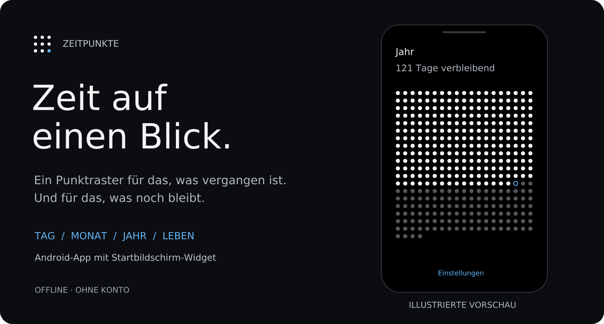

# Zeitpunkte

**Zeit auf einen Blick.**

Sieh, wie viel vom Tag, Monat, Jahr oder deiner gewählten Lebensspanne vergangen ist. Als Android-App und Widget für den Startbildschirm.

**[APK herunterladen](https://github.com/icon3333/zeitpunkte-releases/releases/latest)** · [Mit Obtainium installieren](#mit-obtainium-installieren) · [Datenschutz](#datenschutz)

Illustrierte Jahresansicht, kein Geräte-Screenshot.

## Vier Ansichten, ein Punktraster

| Ansicht | Ein Punkt steht für |
| --- | --- |
| **Tag** | eine Stunde |
| **Monat** | einen Tag im Monat |
| **Jahr** | einen Tag im Jahr |
| **Leben** | eine Woche innerhalb einer selbst gewählten Lebensspanne |

Helle Punkte zeigen vergangene Zeit. Ein umrandeter Punkt markiert den aktuellen Abschnitt. Das Raster gibt es auch als Widget für den Android-Startbildschirm.

## Mit Obtainium installieren

Voraussetzung: **Android 12 oder neuer**.

1. In [Obtainium](https://obtainium.imranr.dev/) **App hinzufügen** öffnen.
2. `https://github.com/icon3333/zeitpunkte-releases` als Quelle einfügen.
3. **Installieren** wählen. Falls Android danach fragt, Installationen aus Obtainium erlauben.

Die Quelle ist öffentlich und benötigt kein GitHub-Konto. Obtainium findet neue Versionen über dieselbe URL. Alternativ unter [Releases](https://github.com/icon3333/zeitpunkte-releases/releases/latest) die signierte `.apk` laden, nicht das Quellcode-Archiv.

Schon eine alte Debug-Testversion installiert?

Android akzeptiert keine Updates mit einer anderen Signatur. Bei einem Signaturkonflikt abbrechen: Eine Deinstallation löscht die lokalen App-Daten.

## Datenschutz

Die App braucht kein Konto und hat keine Internetberechtigung. Eingaben wie Geburtsdatum und Zielalter bleiben in den App-Daten auf dem Gerät.

Dieses Repository dient der Verteilung von Zeitpunkte. Der Quellcode der App ist nicht veröffentlicht.
